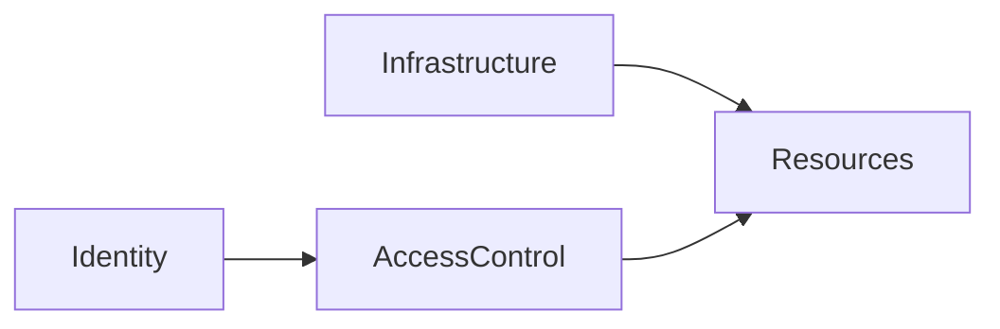
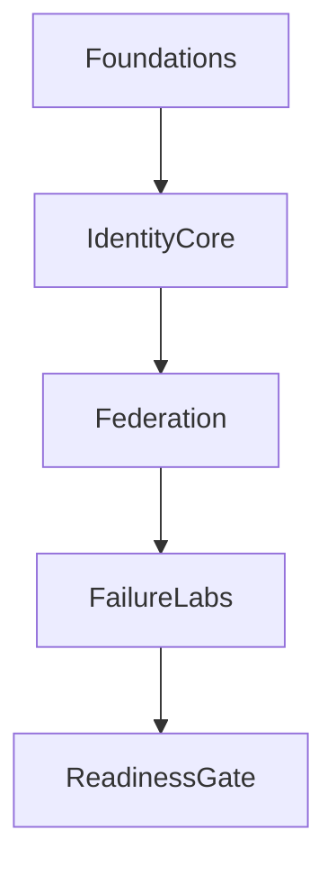
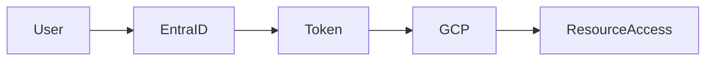
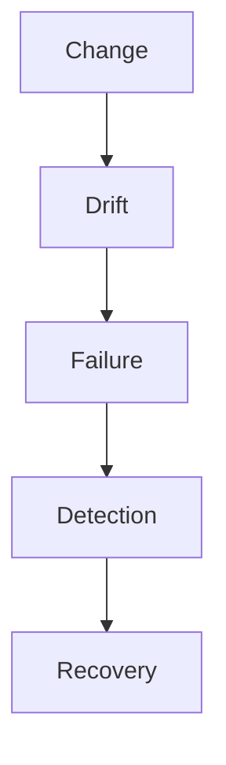
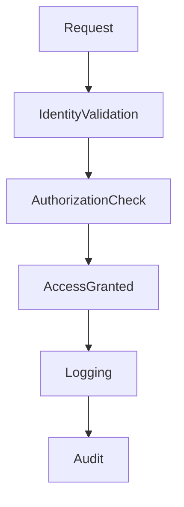

### Configuration

[Linter Rules](Linter-Rules.md)

[Disabling Linter Rules](Obsidian-Linter-Disabling-Rules)

[Markdown Cheatsheet](Markdown-Cheat-Sheet)

## Links

[[SEIR-I-16-Week-Curriculum]] 
[[SEIR-to-SEIR-I-Pathway]] 
[[SEIR-I-with-Kubernetes-Pathway]] 
[GCP-Masterclass-Notes-Compute](GCP-Masterclass-Notes-Compute)

---

# SEIR-I — Systems Engineering & Identity Responsibility

## Program Definition

> **Infrastructure determines what can exist. 
> Identity determines who is trusted.**

This program trains engineers to operate across:

- **Infrastructure plane (GCP)**
- **Identity control plane (Entra ID)**
- **Federated trust systems**

---

# 1. Program Philosophy

## Identity as the Control Plane

| Belief                             | Operational Implication               |
| ---------------------------------- | ------------------------------------- |
| Identity changes are high-impact   | Require **pre-change reasoning**      |
| Identity failures > infra failures | Treat as **system outages**           |
| Automation follows understanding   | Build **read-only validation first**  |
| AI is bounded                      | Maintain **human decision authority** |

---

## Identity Vs Infrastructure Model

> [!IMPORTANT]
> Infrastructure defines **existence**. 
> Identity defines **access and trust**.

---

## Engineering Mindset

- Think in **blast radius**, not convenience
- Prioritize **reversibility and recovery**
- Treat IAM changes like:
  - Kernel changes
  - Network policy changes

---

# 2. Program Structure

## Timeline

| Duration  | Model          | Constraint                                     |
| --------- | -------------- | ---------------------------------------------- |
| 18 Months | Apprenticeship | Learning must be **deliberate and controlled** |

## Program Flow

### Key Gate

- **16-week core → Lab 1 qualification**
- Advancement = **earned, not automatic**

---

# 3. Technology Stack

## Layered Architecture

| Layer                | Technology                     |
| -------------------- | ------------------------------ |
| Infrastructure Plane | GCP                            |
| Identity Authority   | Entra ID                       |
| Federation           | SAML, OIDC, OAuth              |
| Automation           | PowerShell, Python             |
| IaC                  | Terraform                      |
| CI/CD                | Pipelines + approval gates     |
| AI                   | OpenAI, Vertex (analysis only) |

---

## Cross-Cloud Identity Flow

> Federation extends **authentication**, not authorization.

---

# 4. Skill Domains

## Cloud & Infrastructure

- GCP hierarchy (org → folder → project)
- VPC + compute design
- Terraform-based provisioning
- CI/CD with approval gates
- Evidence-driven debugging

---

## Identity & Access Management (Primary)

| Area               | Capability               |
| ------------------ | ------------------------ |
| Entra ID           | Tenants, groups, apps    |
| Federation         | SAML, OIDC               |
| Workforce Identity | Cross-cloud auth         |
| IAM Design         | Least privilege          |
| Risk Control       | Blast radius containment |

---

## Automation & Tooling

- PowerShell → identity enumeration
- Python → validation & evidence
- Change control patterns:
  - Read → Validate → Approve → Write

---

## AI Usage Model

| Allowed             | Not Allowed            |
| ------------------- | ---------------------- |
| Analysis            | Decision-making        |
| Summarization       | Autonomous IAM changes |
| Pattern recognition | Trust assignment       |

> [!WARNING]
> AI output must be validated against **logs and system state**

---

# 5. Job Market Relevance

## Why Identity Skills Matter

- Multi-cloud requires **federated trust**
- IAM failures = **high-cost incidents**
- Federation = **complex, fragile systems**

---

## Role Mapping

| Role                        | Capability Alignment         |
| --------------------------- | ---------------------------- |
| IAM Engineer                | SSO, federation, recovery    |
| Cloud Identity Engineer     | Cross-cloud trust            |
| Platform Engineer           | Identity-aware systems       |
| Security Engineer           | Access risk control          |
| Enterprise Systems Engineer | Infra + identity integration |

---

## Graduate Capabilities

- Design identity architectures
- Debug access via **logs (not assumptions)**
- Communicate identity risk
- Operate under:
  - Audit
  - Compliance
  - Incident pressure

---

# 6. Challenge Labs (Controlled Risk)

## Lab Design Principle

> Labs simulate **real failure conditions**, not ideal scenarios.

---

## Lab Breakdown

| Lab              | Scenario                  | Skill Developed        |
| ---------------- | ------------------------- | ---------------------- |
| Lockout Lab      | Access fails after change | Recovery discipline    |
| Federation Drift | SSO breaks unexpectedly   | Cross-system debugging |
| Blast Radius     | Over-permission exposure  | Least privilege        |
| AI Failure       | AI contradicts logs       | Human validation       |

---

## Identity Failure Model

---

## Midpoint: Identity Suffering Week

### Failure Sequence

- Access denial
- Federation break
- Conditional access conflict

### Outcomes

- Controlled response under pressure
- Respect for identity systems
- Improved judgment

---

# 7. Certifications (Optional)

| Certification         | Focus                        |
| --------------------- | ---------------------------- |
| SC-300                | Identity (primary alignment) |
| AZ-104                | Azure operations             |
| GCP Security Engineer | IAM + security               |
| GCP Architect         | Architecture + identity      |

> Certifications validate knowledge — **not decision-making ability**

---

# 8. Program Boundaries

## What SEIR-I Is

- Identity-first apprenticeship
- Failure-driven learning
- Controlled automation model
- Human-governed systems

## What SEIR-I Is Not

- Fast-track cert program
- Tool-focused training
- Uncontrolled automation
- AI-driven decision systems

---

# 9. Core Principles (Quick Reference)

| Principle                        | Implementation      |
| -------------------------------- | ------------------- |
| Identity first                   | Design before tools |
| Logged or didn’t happen          | Full auditability   |
| Least privilege                  | Start minimal       |
| Manual recovery                  | Break-glass control |
| Automation follows understanding | Validate first      |
| Human approval required          | No blind writes     |
| Evidence > assumptions           | Logs drive action   |

---

# 10. Operational Model (End-to-End)

---

# 11. Alignment with Engineering Standards

This program structure aligns with formal engineering documentation and operational rigor:

- Architecture design practices
- Change management discipline
- Incident response workflows

Reference template:

---

# Final Takeaway

> [!SUMMARY]
>
> - Identity is the **control plane of trust**
> - Federation introduces **distributed risk**
> - Automation without validation = **uncontrolled change**
> - Engineers are trusted based on **judgment, not tools**
