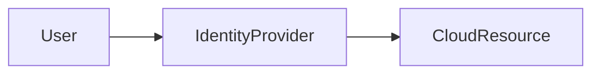
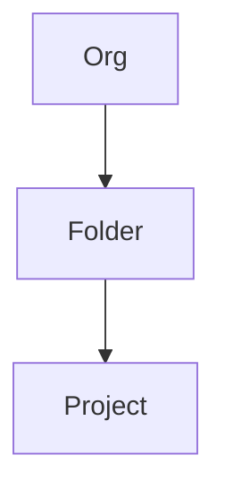
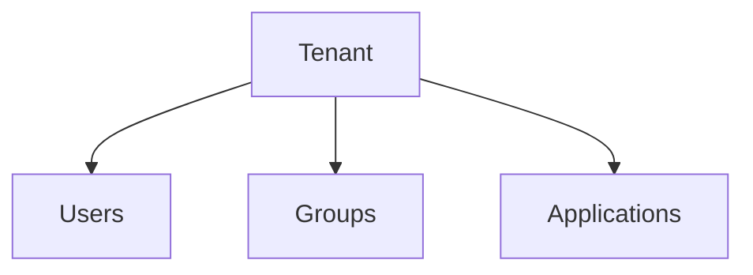
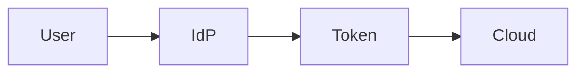
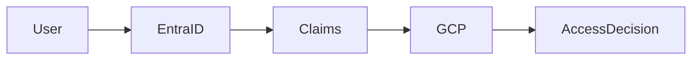
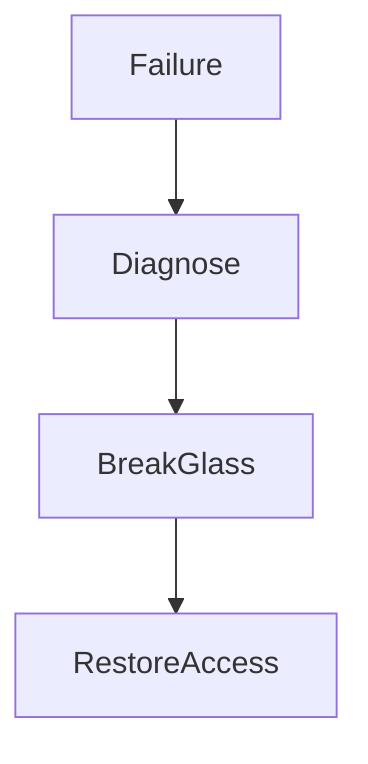
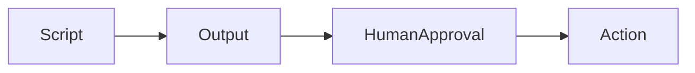

### Configuration

[Linter Rules](Linter-Rules.md)

[Disabling Linter Rules](Obsidian-Linter-Disabling-Rules)

[Markdown Cheatsheet](Markdown-Cheat-Sheet)

## Links

[[SEIR-I-Program-Overview]] 
[[SEIR-to-SEIR-I-Pathway]] 
[[SEIR-I-with-Kubernetes-Pathway]] 
[GCP-Masterclass-Notes-Compute](GCP-Masterclass-Notes-Compute)

---

# SEIR-I — 16-Week Curriculum (GCP + Entra ID)

## Core Philosophy

> [!IMPORTANT]
> **Identity is the control plane — not an implementation detail.**

- Infrastructure = **resource plane**
- Identity = **trust + control plane**
- Failure in identity ⇒ **system-wide outage**

---

# Phase 0 — Orientation & Mental Models (Weeks 1–2)

## Week 1 — What Identity Actually Controls

### Key Concepts

- **Identity governs access to everything**
- Failures in identity:
  - Harder to recover than infrastructure
  - Often block all access (lockout scenarios)

### Core Definitions

| Concept        | Meaning                               |
| -------------- | ------------------------------------- |
| Authentication | Who are you?                          |
| Authorization  | What can you do?                      |
| Trust Boundary | Where identity decisions are enforced |

### Key Insight

- Identity lockout = **total system outage**
- Access recovery > infra rollback in complexity

---

## Week 2 — Cloud as a Trust Boundary

### System Model

### Key Concepts

- GCP = **resource plane**
- Entra ID = **identity/trust plane**
- Cloud = **distributed trust system**, not just compute

> [!IMPORTANT]
> Trust boundary = where **authentication ends** and **authorization begins**

---

# Phase 1 — GCP Foundations (Weeks 3–5)

## Week 3 — GCP Projects & IAM

### Resource Hierarchy

### Identity Types

| Type            | Usage                         |
| --------------- | ----------------------------- |
| Human Identity  | Users (interactive access)    |
| Service Account | Workload identity (non-human) |

### Rules

- Never use service accounts as humans
- Projects define:
  - **Isolation boundary**
  - **Blast radius**

---

## Week 4 — Compute & Networking

### Components

- GCE (VMs)
- VPC (network isolation)
- Firewalls (policy enforcement)

### Security Model

| Principle      | Meaning                   |
| -------------- | ------------------------- |
| Default Deny   | Block everything first    |
| Explicit Allow | Only open required access |

> [!WARNING]
> Any rule added for “convenience” likely violates least privilege

---

## Week 5 — Logging & Evidence

### Logging Types

| Log Type       | Purpose               |
| -------------- | --------------------- |
| Admin Activity | Control plane changes |
| Data Access    | Resource interaction  |

### Key Principle

> **If it’s not logged, it didn’t happen**

### Outcomes

- Identify:
  - Who accessed what
  - When
  - Why access failed

---

# Phase 2 — Entra ID Foundations (Weeks 6–8)

## Week 6 — Identity Core Concepts

### Identity Structure

### Key Concepts

| Component | Purpose                  |
| --------- | ------------------------ |
| Tenant    | Identity boundary        |
| Users     | Individual identities    |
| Groups    | Policy scaling mechanism |

> [!IMPORTANT]
> Groups scale access. Users do not.

---

## Week 7 — Federation & SSO

### Protocol Comparison

| Protocol | Purpose                    |
| -------- | -------------------------- |
| SAML     | Enterprise SSO (XML-based) |
| OIDC     | Modern auth (API/web apps) |

### Federation Flow

### Failure Points

- Certificate expiration
- Metadata mismatch
- Claim misconfiguration

> Federation = **chain of trust dependencies**

---

## Week 8 — PowerShell for Identity

### Scope

- Read-only operations only

### Capabilities

- Enumerate:
  - Users
  - Groups
  - Roles

### Risk Model

| Operation | Risk                     |
| --------- | ------------------------ |
| Read      | Safe (observability)     |
| Write     | High risk (state change) |

> Use:

- `-WhatIf`
- Logging
- Audit trails

---

# Phase 3 — GCP + Entra Integration (Weeks 9–11)

## Week 9 — Workforce Identity Federation

### Trust Separation

| Layer    | Responsibility |
| -------- | -------------- |
| Entra ID | Authentication |
| GCP IAM  | Authorization  |

### Flow

> [!IMPORTANT]
> Federation delegates **authentication only**, not authorization

---

## Week 10 — Controlled Access Mapping

### Mapping Model

| Entra Group | GCP Role |
| ----------- | -------- |
| Dev Team    | Viewer   |
| Ops Team    | Editor   |

### Principle

- Start minimal
- Expand with **documented justification**

---

## Week 11 — Identity Failure & Recovery

### Common Failures

- Cert expiration
- Federation timeout
- Config drift

### Recovery Model

### Break-Glass Requirements

- Offline protected
- Audited
- Manual only

> Not a backdoor — a **controlled emergency path**

---

# Phase 4 — Automation with Restraint (Weeks 12–14)

## Week 12 — Python for Evidence

### Use Cases

- Read logs
- Validate IAM
- Verify access

### Rule

- No IAM modification

---

## Week 13 — PowerShell + Python

### Separation of Duties

| Tool       | Responsibility   |
| ---------- | ---------------- |
| PowerShell | Identity queries |
| Python     | GCP validation   |

### Automation Model

> Observability = reproducibility

---

## Week 14 — Pre-Lab Discipline

### High-Risk Areas

- Federation config
- Group-role mapping
- Logging gaps

### Go / No-Go Checklist

- Logs validated
- Recovery tested
- Access verified

---

# Phase 5 — Readiness & Gate (Weeks 15–16)

## Week 15 — Mock Lab

### Scenario

- Simulated federation outage

### Required Skills

- Evidence-based debugging
- Controlled response
- No panic changes

---

## Week 16 — Readiness Review

### Evaluation Areas

- System explanation (verbal)
- Trust boundary diagram
- Script limitations

> [!IMPORTANT]
> “Deferred” = safety mechanism, not failure

---

# DevSecOps Principles Summary

| Principle                 | Phase Applied |
| ------------------------- | ------------- |
| Identity = control plane  | Weeks 1–2     |
| Least privilege           | Weeks 4, 10   |
| Read-first automation     | Weeks 8, 12   |
| Federation = auth only    | Week 9        |
| Manual break-glass        | Week 11       |
| Human approval for writes | Week 13       |
| Evidence-driven debugging | Weeks 5, 15   |
| Readiness gates           | Week 16       |

---

# Alignment with Architecture Documentation

> This curriculum directly supports structured architecture documentation practices such as:

### Key Alignment Areas

- Identity as a **security control layer**
- Clear **trust boundaries**
- Defined **risk and recovery procedures**
- Observable and auditable systems

---

# Final Takeaway

> [!SUMMARY]
>
> - Identity failures are **system failures**
> - Federation introduces **distributed trust risk**
> - Automation without observability = **uncontrolled change**
> - Discipline, not tooling, determines readiness
